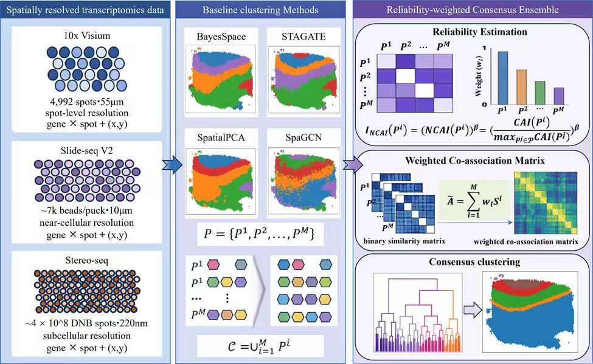

# SpaRWE

**Reliability-Weighted Co-association Ensemble for Robust Spatial Domain Identification**

## 1. Overview

Spatial transcriptomics (ST) technologies enable the characterization of gene expression profiles while preserving spatial information, providing new opportunities to investigate tissue architecture and spatial heterogeneity. However, spatial domain identification remains challenging because of the complexity of tissue organization, data noise, and the variable performance of individual clustering methods.

To address these challenges, we developed **SpaRWE**, a reliability-weighted consensus ensemble framework for robust spatial domain identification. SpaRWE integrates heterogeneous clustering solutions from multiple spatial domain identification methods while explicitly accounting for differences in their reliability.



The framework comprises two major components:

1. **Reliability quantification.** The Normalized Crowd Agreement Index (NCAI) is used to quantitatively assess the reliability of each base clustering solution based on its agreement with the other clustering results.
2. **Reliability-weighted consensus ensemble.** NCAI-derived weights are incorporated into the construction of a weighted co-association matrix. Average-linkage hierarchical clustering is then applied to obtain the final consensus spatial domains.

By incorporating the estimated reliability of individual clustering solutions into consensus construction, SpaRWE reduces dependence on any single base method and provides a unified strategy for robust spatial domain identification.

## 2. Repository Structure

```text
SpaRWE/
├── README.md
├── figures/
│   └── SpaRWE_framework.jpg
├── SpaRWE/
│   └── [core SpaRWE implementation]
├── ComparativeMethods/
│   ├── BaseMethods/
│   │   ├── SpatialPCA.R
│   │   ├── BayesSpace.R
│   │   ├── SpaGCN.py
│   │   └── STAGATE.py
│   └── EnsembleMethods/
│       ├── SpatialESD.m
│       └── EnSDD.R
└── DownstreamAnalysis/
    └── [downstream analysis scripts]
```

## 3. Comparative Methods

The repository includes implementations or analysis scripts for the following comparison methods.

**Baseline clustering methods**
- SpatialPCA
- BayesSpace
- SpaGCN
- STAGATE

**Ensemble comparison methods**
- SpatialESD
- EnSDD

These methods are used as comparators for evaluating the performance of SpaRWE.

## 4. Downstream Biological Analysis

The repository includes scripts for downstream analyses of the identified spatial domains, including:

- Differential expression analysis
- Spatially variable gene analysis
- Functional enrichment analysis (GO and KEGG)
- Gene set enrichment analysis (GSEA)
- Pseudotime analysis
- Cell–cell communication analysis

The availability of individual analyses depends on the corresponding input data and software dependencies.

## 5. Data Availability

SpaRWE was evaluated using sequencing-based spatial transcriptomics datasets generated with platforms including:

- 10x Visium
- Stereo-seq
- Slide-seqV2

The framework can be applied to other spatial transcriptomics datasets when the base clustering results are generated for the same spatial observations and aligned consistently.

## Contact

For questions regarding the SpaRWE method or its implementation, please contact:

**Email:** dr20250051134@sxmu.edu.cn
